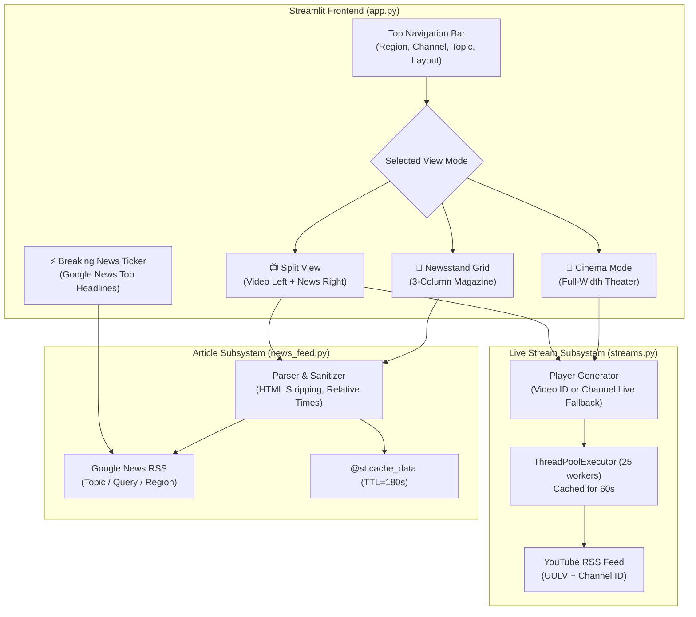

# 🌐 NewsHub: 24/7 Global Live Streams & Google News Intelligence

A next-generation multimedia news aggregation platform built with **Streamlit** and **Python**. NewsHub pairs international 24/7 live television broadcast streams with real-time, synchronized **Google News** breaking article feeds—creating a unified command center for global journalism without requiring any API keys or paid subscriptions.

Inspired by and extending upon the foundation of [GlobalNews](https://github.com/vedantparkhe777-alt/GlobalNews), NewsHub introduces dual-modality news consumption (video + text), automated regional feed synchronization, search across Google News, article bookmarking, resilient stream detection, and custom responsive layouts.

---

## 🚀 Key Innovations & Differences from GlobalNews

| Feature | GlobalNews (Original) | NewsHub (This Platform) |
| :--- | :--- | :--- |
| **Media Consumption** | Live YouTube streams only | **Dual-Stream**: Live video broadcasts + real-time Google News articles |
| **Breaking News Ticker** | ❌ None | **Live Ticker**: Interactive marquee of breaking headlines from Google News |
| **Google News RSS** | ❌ None | **Full Integration**: Regional editions, topic filters (Tech, Business, Science, etc.), and keyword search |
| **Regional Auto-Sync** | Channels filtered only | **Cross-Sync**: Selecting a region filters broadcast channels **and** loads corresponding Google News articles |
| **Live Stream Reliability** | Unauthenticated requests (often 404/blocked) | **Browser Headers + Fallback Embeds**: Uses real browser `User-Agent` and automated fallback to native channel live players |
| **Viewing Modes** | Single fixed layout | **3 Adaptive Modes**: Split View (Stream + News), Cinema Mode, and Newsstand Grid |
| **Reading List / Bookmarks** | ❌ None | **Persistent Session Bookmarks**: Save articles to read later, managed via sidebar drawer |
| **Channel Discovery** | Dropdown selection only | **Random Discovery Engine**: "Surprise Stream" and "Live-Only" one-click jump buttons |
| **Silent Auto-Refresh** | Basic 60s `@st.fragment` | **Optimized `@st.fragment(run_every="60s")`** with live/standby indicators and channel counters |

---

## 🛠️ Tech Stack & Architecture

- **Frontend Framework**: [Streamlit](https://streamlit.io/) (`st.set_page_config`, `@st.fragment`, `@st.cache_data`, `components.html`)
- **Live Stream Detection**: YouTube Atom/RSS feeds via `UULV` live playlist IDs with `requests` and Python standard library `xml.etree.ElementTree`
- **Article Intelligence**: Google News RSS feeds with automated HTML cleanup, publisher extraction, and relative timestamp calculations (`email.utils`, `datetime`)
- **Concurrency**: `concurrent.futures.ThreadPoolExecutor` (25 parallel workers) for sub-second status sweeps
- **Styling**: Custom CSS styling with pulsing live indicators, glassmorphic cards, and responsive embedded video players



---

## 📦 Project Structure

```text
NewsHub/
├── app.py              # Main Streamlit application and layout router
├── channels_data.py    # Directory of 60+ global channels, metadata & regional mappings
├── news_feed.py        # Google News RSS fetching, cleaning & relative-time parser
├── streams.py          # YouTube RSS live stream status checker & fallback embed generator
├── styles.py           # Custom CSS styling (pulsing badges, ticker, cards)
├── requirements.txt    # Minimal dependencies (streamlit, requests)
└── README.md           # Documentation
```

---

## ⚡ Installation & Local Setup

### 1. Clone or Navigate to the Repository
```bash
cd NewsHub
```

### 2. Create and Activate a Virtual Environment
```bash
# On Windows
python -m venv .venv
.venv\Scripts\activate

# On macOS/Linux
python3 -m venv .venv
source .venv/bin/activate
```

### 3. Install Dependencies
```bash
pip install -r requirements.txt
```

### 4. Run NewsHub
```bash
streamlit run app.py
```
The app will open automatically in your browser at `http://localhost:8501`.

---

## 🌍 Channel Directory & Coverage

NewsHub includes major public and independent broadcasters across key global regions:

- **United States**: NBC News NOW, ABC News Live, CBS News Streaming, CNN, Fox News, LiveNOW from FOX, MSNBC, PBS NewsHour, Associated Press, Bloomberg TV, CNBC, Yahoo Finance, Forbes, WSJ, The Washington Post, The New York Times, USA Today, NewsNation, C-SPAN, NASA TV.
- **United Kingdom**: BBC News, Sky News, GB News, Reuters, The Telegraph, The Guardian, The Sun, Channel 4 News.
- **Europe**: Euronews English, France 24 English, DW News (Germany), TVP World.
- **Middle East & Africa**: Al Jazeera English, TRT World, Africanews, SABC News, eNCA, i24NEWS English.
- **India**: WION, India Today, NDTV, Aaj Tak, Republic World, CNN-News18, Times Now, DD India.
- **Asia Pacific**: CNA (Singapore), South China Morning Post, CGTN, NHK WORLD-JAPAN, Arirang News, KBS WORLD TV, TaiwanPlus News.
- **Australia & Canada**: ABC News Australia, Sky News Australia, 9 News Australia, 7NEWS Australia, CBC News, Global News Canada, CTV News.

---

## 💡 Troubleshooting & Notes

- **Stream Embedding Policies**: Certain broadcasters periodically restrict embedding on third-party domains or rotate stream keys. In such cases:
  1. NewsHub displays the **"⚪ DIRECT STREAM"** fallback player.
  2. You can click **"↗ Watch on YouTube Live"** to open the broadcast directly in YouTube.
  3. Toggle **"Force Native Channel Embed"** in the sidebar to toggle between direct video ID mode and channel live player mode.
- **Network Firewalls / Captive Portals**: If running on corporate/campus networks that inspect or restrict streaming media, ensure outbound HTTPS access to `youtube.com` and `news.google.com` is permitted.

---

## 📄 License & Attribution

- Built as an open, educational enhancement inspired by [GlobalNews](https://github.com/vedantparkhe777-alt/GlobalNews).
- All live streams and news articles remain the intellectual property of their respective broadcasters and publishers.
